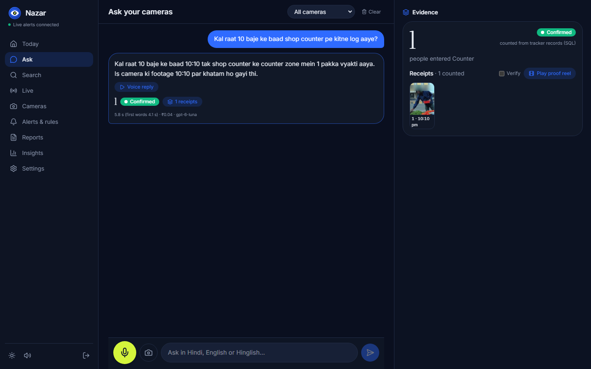
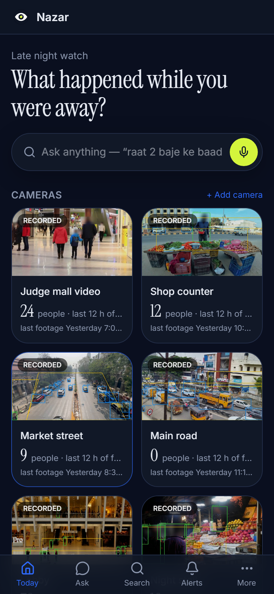
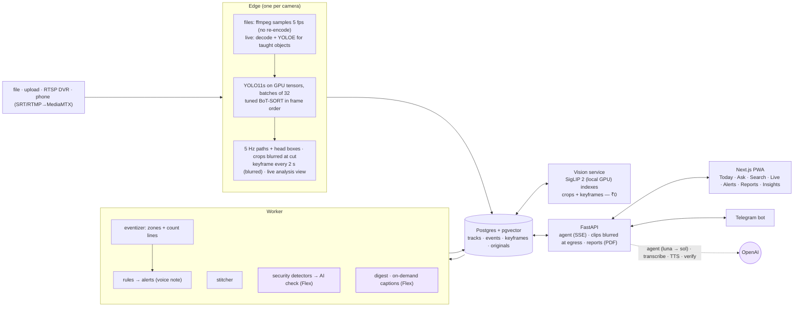

# Nazar — ask your CCTV anything, in your own language.

**Nazar turns any CCTV — or any video you have — into a security analyst you can talk to, in Hindi, English or
Hinglish. Search footage by words or by photo, get counts with receipts, teach it what to watch, and get a
police-ready incident report in one tap. Indexing footage costs ₹0 in AI — you only pay when you ask.**


<p align="center">
  
  
</p>

> Built solo for Builders 2026 (OpenAI × Equal AI), Build Creative track. v1 was built in the first night; v2 (this
> README) in the second. Every number below comes from a script run on 22 Nov 2026 on one laptop (RTX 4050, 8 GB RAM).

## The problem
India's shops, homes, offices and housing societies already paid for CCTV — usually a DVR that records 24×7 and
that nobody watches. When something happens, someone scrubs hours of footage on a tiny screen. The cameras see
everything; the owner can ask nothing. Police reviewing footage (a lost child at a mela, a chain-snatching) face
the same wall of video.

## Show it · Say it · Find it — the three pillars
| | Try | What comes back |
|---|---|---|
| **1. Search like Google Photos** | "person carrying a bag", "laptop on a desk" — or a **photo** of a bag/jacket/vehicle | every similar moment across all cameras, ranked, playable; AI checks the top hits; a cross-camera **journey** (clothes/objects only — never faces) |
| **2. Teach it anything, no training** | "Builders venue pe laptop pe nazar rakho", "Jab bhi koi desk 14 se bag uthaye, mujhe batana" | open-vocabulary detection (YOLOE) starts on that camera; the rule is **replayed on yesterday first**, then watches live and alerts by voice note — in the app and on **Telegram** |
| **3. Proof, not claims** | "Kal raat 10 baje ke baad counter pe kitne log aaye?" | a **Confirmed** count from SQL with every counted person as a playable **receipt**, a **proof reel**, "how this was computed" for any analysis, and a **FIR-ready PDF** with SHA-256 hashes |

Plus security analytics out of the box — loitering, abandoned bag, object taken, running, fall, crowding,
after-hours presence, possible snatch — each a *Candidate* until a short AI check of blurred frames agrees.

## Live demo
**https://main.d3c12rzknieyam.amplifyapp.com** (passcode `nazar2026`). The web app is hosted on **AWS Amplify**
(app `nazar`, us-west-2). The API and video pipeline run on the owner's laptop GPU (RTX 4050), reached over a secure
HTTPS tunnel, so the link works while that laptop is on. Footage stays on the owner's machine: that is the privacy
design. The full cloud path (one CPU EC2 + RDS + S3) is scripted in [`infra/DEPLOY.md`](infra/DEPLOY.md).

## Demo film
**`demo/nazar_film.mp4`** — the narrated film (with sound): a narrator explains each chapter, and you **hear** the
owner's real Hindi voice note, Nazar's real spoken Hindi reply and the live alert's Hinglish voice note
(`scripts/film_build.py` mixes them onto the app recording, loudness-normalised). *Watch link: upload the film and
paste the link here.*

### What v3 added (22 Nov 2026)
- **Proof that it works:** every one of the 66 API routes tested (auth, shapes, errors), every rule trigger and
  security detector on recorded footage, the Telegram bot's real handlers, a 12-note voice matrix in 8 languages, and
  an end-to-end suite in real Chrome where every kind of clip must actually play — see [`docs/TEST_PLAN.md`](docs/TEST_PLAN.md).
- **Faster answers:** count questions are answered from the SQL result in one model round — 6-question profile p50
  8.0 s → 4.1 s, first words 6.0 s → 3.3 s; counts ~2.5 s.
- **Riders are not pedestrians:** a person riding a motorcycle/bicycle is counted separately; count accuracy 3/3
  windows exact.
- **Night-shift design:** warm ink, one signal-amber accent, REC red, Fraunces + Geist + Geist Mono, CCTV crop-mark
  frames on every video, a "paper" light theme.
- **Honesty fixes:** no "Confirmed 0" for a time with no footage; the model's year slips are corrected server-side;
  peak counts carry receipts; Hindi/Tamil/Telugu/Bengali/Gujarati/Kannada voice notes all answered with the SQL number.

## Demo video (silent, captioned)
**`demo/nazar_full.mp4`** — the complete product in chronological order, recorded from the real app in Chrome with
`scripts/demo_full.mjs` (waits sped up 8×): login → Today → add cameras (upload + live analysis, CCTV builder with Test
connection, Excel import, phone) → zones & count lines → count with receipts, chart drill-down, human review and proof
reel → any analysis with its SQL → heatmap → Hindi voice note → face-search refusal → search by words + AI
verification → journey → search by photo → teach by name (YOLOE) and by photo → rule replayed on yesterday →
WebRTC live wall → live alert → security events → incident PDF → reports → Telegram pairing → Insights.

A shorter judge cut, `demo/nazar_v2.mp4` (`scripts/demo_video_v2.mjs`):
upload the Builders-venue clip → live analysis view → Hinglish count with receipts + proof reel → "any analysis"
with its SQL → search by words with AI verification → journey → search by photo → teach "laptop" → bag rule replays
→ the bag clip plays as a live camera → **live alert** with snapshot + voice note → incident PDF → Insights.

## Run it (Windows, PowerShell)
```powershell
docker compose -f infra/docker-compose.yml up -d                        # Postgres 16 + pgvector (port 5433) + MediaMTX
python -m venv .venv; .\.venv\Scripts\Activate.ps1
pip install torch torchvision --index-url https://download.pytorch.org/whl/cu121; pip install -e backend
python scripts/fetch_samples.py; python scripts/download_models.py     # demo clips + YOLO/YuNet weights
python scripts/demo_setup.py                                           # 8 demo cameras incl. samples/hackathon.mp4
powershell -ExecutionPolicy Bypass -File scripts\start_all.ps1           # vision, worker, API, web (+ Telegram bot)
```
Open http://localhost:3000 (passcode from `DEMO_PASSCODE`). Checks: `python scripts/check_env.py`,
`python scripts/check_models.py`, `powershell -File scripts\smoke.ps1` (must print `SMOKE: PASS`).

## How it works


- **Trajectories are the truth.** The edge stores every object's path (normalized boxes at 5 Hz, with a head box
  for people). One eventizer derives zone enter/exit/dwell and count-line in/out events; replay and live rules run
  the same evaluator.
- **Counts come from SQL, and every count shows its receipts.** "People seen" = root tracks ≥ 1.5 s with max
  confidence ≥ 0.6 (filters ID fragments and flicker). Tap a chart bar to see who was counted in that hour; mark a
  receipt wrong and the card shows "17 by AI · 16 after your review" (stored for evaluation).
- **Any analysis, safely.** The agent can write one SELECT over whitelisted views (`v_tracks`, `v_events`,
  `v_crossings`, `v_hourly`, …). The server validates it with sqlglot and runs it as a read-only role with a 5 s
  timeout; the SQL is shown under "how this was computed".
- **Local visual index.** A SigLIP 2 model indexes every track crop and a scene keyframe every 2 s — no AI call.
  Questions about things that were never tracked ("was the shutter open?", "laptop on a desk") search keyframes.
- **Cheap model first.** `gpt-6-luna` answers; it escalates to `gpt-6-sol` when unsure or when a tool fails. Answers
  stream token by token over SSE; the voice reply is synthesized as soon as the text is complete.

### Evidence levels (decided only by server code — the model can never set or upgrade one)
| Level | Rule | Looks like |
|---|---|---|
| **Confirmed** | a tracker/database fact: a SQL count, a zone entry, a line crossing, a timestamp, an analytics row | solid green pill |
| **Probable** | local similarity **and** an independent check agree: matching attributes, or a **recorded** AI verification "yes" of the blurred image | amber pill, half-filled dot, "AI-verified" |
| **Candidate** | similarity or a heuristic only | grey dashed outline, "check this", never ranked above the others |

### Privacy
- **No face recognition, ever.** Photo search compares clothes, bags and vehicles on face-blurred images; a
  face-only photo is refused; every photo search is written to an audit log with its purpose.
- **Blur at egress:** the original video stays on the owner's machine (like a DVR) and is never served. Everything
  that leaves the pipeline — crops, keyframes, clips, live view, snapshots, PDFs, Telegram media — is blurred with
  the stored head boxes plus a YuNet face pass on every image.
- OpenAI only sees blurred crops/keyframes at `detail: low` and the owner's questions. Media retention: 7 days.

## Measured results (22 Nov 2026, one laptop: i5-13420H, RTX 4050 6 GB, 8 GB RAM)
**Speed** — `python scripts/bench_pipeline.py` on a 30-minute 1280×720 file built from the demo clips:

| Pipeline | Footage | Wall | × real time |
|---|---|---|---|
| v1: OpenCV decode every frame + per-frame YOLO11n + segment re-encode (60 s sample) | 60 s | 46 s | **1.3×** |
| v2: ffmpeg 5 fps sampling + YOLO11s on GPU tensors (batch 32) + ordered ByteTrack, no re-encode (BoT-SORT default since: 7.7x on the 62 s street clip vs 7.4x) | 1800 s | 203 s | **8.9×** |
| v2 on the Builders-venue clip (848×478, 5.5 min) | 330 s | 18.6 s | **17.7×** |

Timestamp drift at the end of the 30-minute file: 0.13 s. The 30-minute test is rush-hour street/mall footage with
2,636 tracks; there the CPU side (tracker + Python) is the bottleneck, so it misses the 15× goal. Model choice:
yolo11n/26n/11s/26s all ran ~80 fps through the ultralytics predictor (CPU-bound); with GPU-side letterboxing yolo11s
reached 100–145 fps and finds more objects, so it is the default.

**Answers** — `python scripts/eval_battery.py`: 27 questions (counts, analysis, compare, peak, visual search, photo,
security, heatmap, look-now, rule, report, face-search refusal, a vague "kitne?") in Hindi, Hinglish and English:

| Result | First words p50 / p90 | Full answer p50 / p90 | Agent cost p50 / p90 |
|---|---|---|---|
| **27 / 27 correct** (twice); every Confirmed number re-computed from SQL and equal | 8.0 s / 10.9 s | 9.7 s / 15.8 s | ₹0.03 / ₹0.11 |

25 of 27 answered by `gpt-6-luna`; two escalated to `gpt-6-sol` (₹0.58 and ₹1.30). An earlier run: first words 7.0 s, full 8.8 s p50. The 2.5 s / 5 s latency targets are **not
met**: an answer takes 2–3 model rounds; status lines ("Counting from the tracker…") appear while tools run.

**Unit costs** — from the `usage` table (Insights page), 62 questions:

| | ₹ |
|---|---|
| AI cost to index footage (detection, tracking, counting, SigLIP 2 index) | **0** |
| One question, p50 / p90, **including the spoken voice reply** | 0.31 / 0.58 (the agent part alone: 0.03) |
| One AI verification call (6–8 images, detail low) | 0.013 (₹0.002 per image) |
| One incident report (AI description + PDF) | 0.016 |
| One on-demand description of a track | 0.005 |

A shop with 500 visitors a day asking 20 questions and getting 3 alerts ≈ **₹6.4 per day** (the Insights page has the
calculator; v1 captioned every track and cost ₹351 per camera-day on busy footage).

**Counting accuracy** — `python scripts/eval_counts.py` against hand counts I made by looking at frames
(`scripts/eval/ground_truth.yaml`):

| Window | Hand count | Nazar | Why it differs |
|---|---|---|---|
| Office desk (ABODA bag clip) | 2 | 2 | — |
| Shop counter (veg stall), people on foot | 3 | 4 | a motorcycle rider is counted as a person |
| Builders venue, first 60 s | 3 | 3 | (ByteTrack gave 5: a half-hidden person re-detected; fixed by the tuned BoT-SORT default) |

**Tracking on MOT17** — `python scripts/eval_tracking.py` (MOT17-11 and -13 with ground truth, sampled at 5 fps like the
edge; both are moving-camera sequences):

| Config | ID switches (mean) | MOTA | IDF1 (approx.) | count error |
|---|---|---|---|---|
| v1: yolo11n + ByteTrack | 44 | 0.31 | 0.38 | 51 % |
| **v2 default:** yolo11s + tuned BoT-SORT (no camera-motion comp.) | 42 | 0.35 | 0.40 | 48 % |
| v2 option for moving/PTZ cameras: + camera-motion compensation | **12** | 0.41 | 0.52 | 50 % |

The default keeps full speed (7.7x on the dense street clip; motion compensation halves it) and fragments less
(133 vs 168 tracks on that clip). MOT17-13 has tiny, far pedestrians: recall is only 0.12-0.21 at imgsz 640.

**Languages** — `python scripts/eval_languages.py` (TTS → transcription round trip): **Hindi, English, Tamil,
Telugu, Bengali, Gujarati, Kannada pass**. Hinglish comes back in Devanagari (same words), Marathi came back in
Gurmukhi script → we do not claim Marathi.

**Live** — `python scripts/live_alert_test.py`: the bag clip playing as a live camera fires the object-removed rule
**3.0 s** after the pickup, with snapshot + voice note; `--teach`: a laptop taught by name is detected live by YOLOE
and its rule fires 4.6 s after it appears; `--photo demo/bag_photo.jpg`: an object taught from a photo (SigLIP 2
appearance match, adaptive threshold) raises a live alert 23 s after it comes into view. Security events on the demo data: the bag pickup on ABODA is flagged
*object taken* and AI-verified to **Probable**; the abandoned-bag heuristic fires but stays a *Candidate* (the AI saw
a person next to the bag).

**Live view** — `cd web; node ../scripts/webrtc_check.mjs`: the Live page plays the blurred view over WebRTC; the
wall-clock stamp burned into the frame was < 0.5 s behind the screenshot time. Live detection: 2.3 fps under load.

**Memory** (W1.9): vision service 2.8 GB private while SigLIP 2 is loaded (kept loaded: unloading/reloading it in-process crashed torch on Windows; opt-in unload via `NAZAR_VISION_IDLE_UNLOAD_S` on Linux), one edge
0.5–1.6 GB, API 0.4 GB, worker 0.45 GB, Postgres 0.1 GB. With Docker, VS Code and a browser this 8 GB laptop had
~0.6 GB free — under the 1 GB goal; 16 GB is comfortable.

## Where OpenAI is used
| Model (env) | Job | When |
|---|---|---|
| `OPENAI_AGENT_FAST_MODEL` (gpt-6-luna) | query agent with 15 strict tools, SSE streaming | every question |
| `OPENAI_AGENT_MODEL` (gpt-6-sol) | escalation, rule compiler, zone suggestions | hard questions, rules |
| `OPENAI_VISION_MODEL` (gpt-6-luna) | verify search hits, describe a clip, look now, security checks (Flex), on-demand captions (Flex) | on demand only |
| `OPENAI_TRANSCRIBE_MODEL` (gpt-4o-transcribe) | voice notes (web + Telegram) | per voice note |
| `OPENAI_TTS_MODEL` (gpt-4o-mini-tts) | spoken replies, alert voice notes, digest | per answer / alert |
| `OPENAI_EMBED_MODEL` (text-embedding-3-small) | caption embeddings (only for described tracks) | on demand |

Every call writes a `usage` row with tokens, images, audio seconds, cost and the **service tier actually served**
(Flex is priced at ~50 %). Model names are read only from the environment.

## Where AWS is used
| Service | Role |
|---|---|
| **EC2** (one c7i.xlarge, CPU only) | MediaMTX ingest, API + edge manager, worker, vision service (CPU), Telegram bot, Caddy HTTPS |
| **RDS PostgreSQL 16 + pgvector** | tracks, events, keyframes (halfvec + HNSW), rules, alerts, usage |
| **S3** (7-day lifecycle) | crops, clips, keyframes, TTS voice notes, reports |
| **Amplify Hosting** | the static web app |

No GPU instances, no Bedrock, one instance. Click-by-click: [infra/DEPLOY.md](infra/DEPLOY.md).

## Connect cameras
- **Upload any video:** Add camera → Upload — several files at once, up to 4 GB / 3 h each, resumable 8 MB parts,
  no re-encode, live analysis view while it runs; ask from the first minute.
- **CCTV / DVR:** Add camera → CCTV / DVR — presets for Hikvision (`/Streaming/Channels/101|102`), Dahua and CP Plus
  (`/cam/realmonitor?channel=1&subtype=0|1`) or any URL; **Test connection** (8 s) shows codec, size, fps and a
  blurred thumbnail or a precise error (auth failed / unreachable / wrong path). Passwords are Fernet-encrypted.
- **Many cameras:** Add camera → Excel import — download the `.xlsx`/`.csv` template, fill it, upload; every row is
  probed (4 at a time) and "Add all working" adds the reachable ones. "Scan network" lists ONVIF cameras.
- **Phone:** Add camera → Phone — Larix Broadcaster with a QR code (SRT/RTMP into MediaMTX).
- **Telegram:** Settings → Get pairing code → send `/pair <code>` to the bot. Ask by text or voice note, send a photo
  to search, receive alerts with snapshot, clip and voice note, and the 8:00 digest.

## Honest limitations
- **Latency** is 10–10 s per answer (p50), above the 5 s goal; first words also arrive late because the text streams only
  in the final model round.
- **Dense scenes:** 8.9× real time (not 15×) on rush-hour footage; counts there are an upper bound (riders count as
  people, partly hidden people are re-detected).
- **Live view:** WebRTC (WHEP via MediaMTX) of the face-blurred stream with the tracker overlay burned in;
  glass-to-glass under ~0.5 s on this laptop, but live detection ran at only 2.3 fps while other services competed
  for the CPU (goal 10 fps). Boxes are drawn into the stream, not on a client canvas.
- **Teach by photo** uses the local SigLIP 2 index (YOLOE visual prompts scored 0.07–0.09 on our blurred 512 px frames):
  matches are Candidates and arrive ~20 s after the object appears (crops are written after 20 s in view).
- **Not done in v2:** the realtime "Call Nazar" voice mode, snatch/theft-dataset evaluation
  (multi-GB downloads; MOT17 was evaluated on 2 sequences), ANPR.
- **Heuristic security events** (running, fall, snatch, loitering) are Candidates until verified; they were checked
  on the demo clips, not on a labelled dataset.
- **Night/IR footage, tiny objects and top-down fisheye views** are weak spots of the detector.
- **The bag-pickup demo clip is constructed** (its second half is the same footage reversed).
- **8 GB RAM** is tight with the vision service loaded.

## Roadmap
- A camera agent inside Equal's AI messenger (the Telegram bot is the prototype).
- An on-site box beside the DVR so video never leaves the premises.
- ANPR for vehicles, multi-site dashboards, Indian-class fine-tunes (auto-rickshaw, e-rickshaw).

## Project structure
```
backend/nazar/core     config, db, eventizer (zones + count lines), rules, levels, OpenAI client, storage, secrets
backend/nazar/edge     per-camera process: ffmpeg file path, detector (GPU tensors + tracker), crops, face blur
backend/nazar/vision   SigLIP 2 service + background indexer (crops, keyframes)
backend/nazar/worker   eventize, rules, alerts, stitcher, security detectors + digest, enricher, retention
backend/nazar/api      FastAPI: agent + tools, analytics (read-only SQL), visual search, clips/reels, reports,
                       uploads, onboarding (RTSP builder, Excel), teach (YOLOE), Telegram pairing
backend/nazar/telegram Telegram bot (long polling)
web/                   Next.js static PWA (dark-first design, Recharts, framer-motion)
infra/                 docker compose (dev/prod), MediaMTX, Caddy, Dockerfile, DEPLOY.md
scripts/               setup, demo data, benchmarks, evaluations, smoke, screenshots, demo video
```

## Built on / credits
**Lineage:** the author previously built SETU — vehicle search across police cameras without readable number plates
(edge detection, appearance fingerprints, pgvector, evidence tiers, "replay first"). Nazar applies the same discipline
to shops and homes.

Open source: Ultralytics YOLO11 / YOLOE + ByteTrack, Google SigLIP 2 (Hugging Face transformers), OpenCV (YuNet),
FastAPI, psycopg + pgvector, PostgreSQL, sqlglot, MediaMTX, ffmpeg, Playwright (PDF), python-telegram-bot, Next.js,
Tailwind CSS, Recharts, framer-motion, lucide icons, Caddy.

Footage: Pexels creators GK Kumawat, Aksinfo7, Karthick S, Joshua Santos, Riaz Uddin (Pexels License); ABODA
abandoned-object dataset; a clip recorded by the author at the Builders 2026 venue (not committed; faces blurred
everywhere it is shown). Details: [samples/SOURCES.md](samples/SOURCES.md).

License: MIT (code). Sample footage keeps its own licence.
